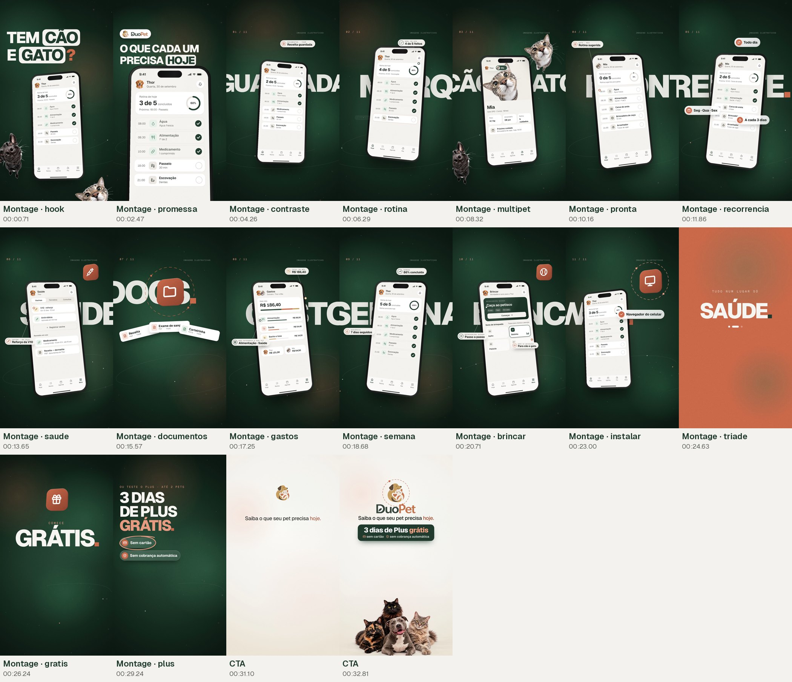
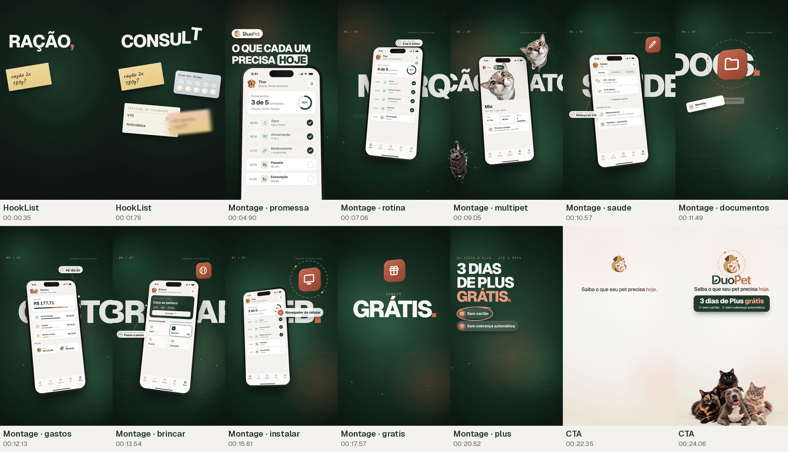
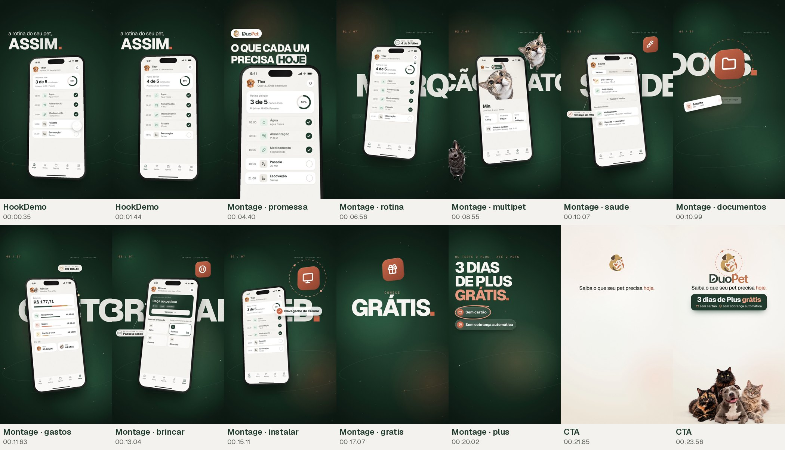
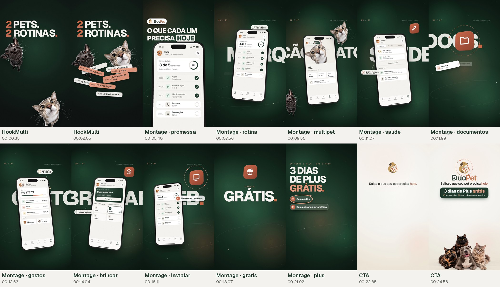
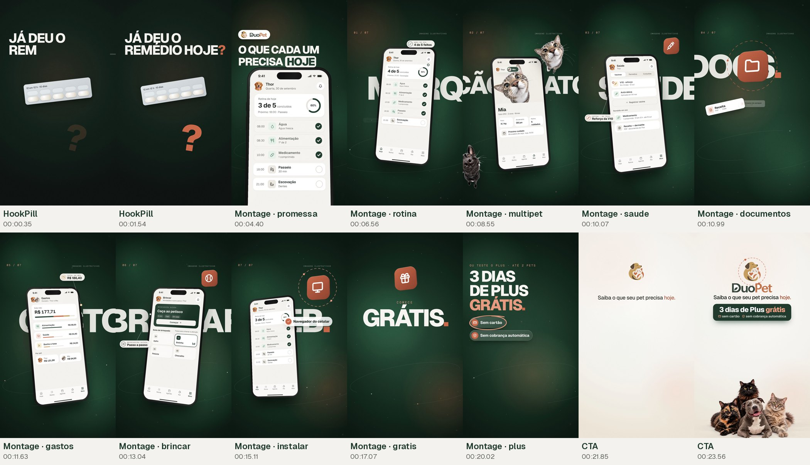
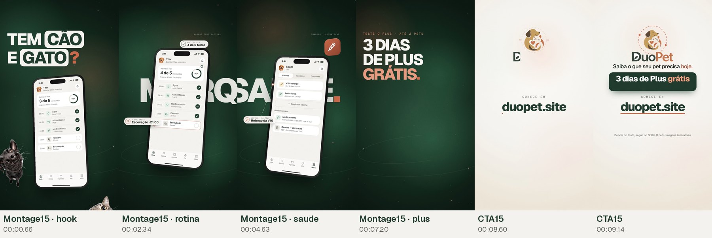

# DuoPet — Storyboard (Fase 6)

Quadros-chave renderizados: `storyboard/<versão>.jpg` (um quadro por cena, no meio da fala).

## Comercial principal (cinematográfico) — `master`

**1. Hook** · 00:00.00–00:04.75
- Imagem: Frame 1 já em movimento: lista da 'sua rotina' (academia, reunião, almoço…) rola e recebe checks terracota. Na virada ('e a do seu pet?') os cards explodem com desfoque de movimento e o cão preto em grande-angular salta de baixo com mola.
- Texto: SUA ROTINA EM DIA. → E A DO SEU PET?
- Movimento: Câmera na mão sutil; cards com motion blur na dispersão; cão com mola (overshoot).
- Som: Tic-tacs a cada check; pop + mola na entrada do cão.
- Locução: “Você organiza a sua rotina inteira… e a do seu pet?”

**2. Chaos** · 00:04.75–00:12.75
- Imagem: Objetos se acumulam no tempo de cada palavra (post-its, cartela, carteirinha, calendário, conversa de família, nota de pet shop). Em 'cabeça', tudo treme e um '?' terracota aparece; no fim, tudo é sugado para um único ponto de luz.
- Texto: RAÇÃO, / REMÉDIO, / VACINA, / CONSULTA… → ESPALHADO EM: CALENDÁRIO, MENSAGENS, MEMÓRIA.
- Movimento: Câmera na mão que aumenta de intensidade; convergência com aceleração contínua e desfoque.
- Som: Batidas de cartão, papel; riser de 1,6 s; sucção.
- Locução: “Ração, remédio, vacina, consulta… um pouco no calendário, um pouco no WhatsApp, e o resto na cabeça.”

**3. Reveal** · 00:12.75–00:17.25
- Imagem: TRANSIÇÃO-ASSINATURA: o ponto de luz vira um disco creme que toma a tela; os cuidados (Água, Alimentação, Medicamento, Passeio, Escovação) saem do centro e se encaixam em ordem; a câmera recua de 2,35× para 1× e revela que tudo está dentro do app, num iPhone. O logo DuoPet entra com mola no nome da marca.
- Texto: Logo DuoPet (símbolo + nome)
- Movimento: Wipe circular (ease in-out) → assentamento em mola com escalonamento de 90 ms → recuo de câmera com curva lenta-longa.
- Som: Impacto grave + brilho; cliques suaves a cada linha que encaixa; pop no logo. A trilha muda de menor para maior (Cmaj9).
- Locução: “No DuoPet, cada cuidado fica no lugar certo.”

**4. Demo** · 00:17.25–00:24.25
- Imagem: Tela Hoje do Thor: 'Rotina de hoje 3 de 5', anel em 60%, 'Próximo: 18:00 · Passeio' destacado. O dedo toca 'Passeio': o círculo preenche, o check se desenha, o anel vai a 80%, o contador vira '4 de 5' e o próximo passa a ser 'Escovação 21:00'. Aparece o toast real do app 'Passeio concluído · Agora · Thor'. No fim, 'Escovação' pulsa e surge o selo 'Falta 1 · 21:00'.
- Texto: VEJA. → MARQUE. → SAIBA O QUE FALTA.
- Movimento: Telefone gira levemente em 3D; aproximação de 1,34× no anel logo após o toque; recuo antes de 'falta'.
- Som: Toque, check em duas notas, subida do anel, toast.
- Locução: “Você vê o que o seu pet precisa hoje, marca o que já fez… e sabe exatamente o que falta.”

**5. Benefits** · 00:24.25–00:31.50
- Imagem: Giro de cubo 3D entre telas reais: Saúde (V10 reforço em 12 dias, Antirrábica, remédio em uso, receita em PDF) → Gastos (R$ 186,40 no mês; por categoria e por pet) → Brincar ('Caça ao petisco · 5 min' e sons de brinquedo com equalizador), com o dálmata saindo de trás do telefone. Em 'cada pet da casa', a tela se abre numa fotografia de 3 gatos e um pitbull; depois volta para o Perfil, onde o seletor troca de Thor para Mia.
- Texto: SAÚDE. / GASTOS. / BRINCADEIRAS. → CADA PET DA CASA. → CÃO OU GATO? → UM PERFIL PARA CADA PET.
- Movimento: Cubo 3D de 0,5 s (ease in-out) por benefício; máscara retangular que expande da tela para o quadro inteiro (interface → foto real).
- Som: Swooshes estéreo, moedas suaves em gastos, apito de brinquedo, toque e pop na troca de pet.
- Locução: “Vacinas, remédios, gastos e até brincadeiras guiadas… pra cada pet da casa, cão ou gato.”

**6. Emotion** · 00:31.50–00:36.75
- Imagem: A tela do perfil se abre (máscara) numa fotografia: gato e border collie juntos, com luz quente e Ken Burns lento.
- Texto: MENOS COISA NA CABEÇA. → MAIS TEMPO JUNTOS.
- Movimento: Máscara retangular que expande; zoom lento de 7%.
- Som: Ar/ambiente; a trilha abre para piano e pad (Fmaj7 → G).
- Locução: “Menos coisa na cabeça… e mais tempo pra quem você ama.”

**7. CTA** · 00:36.75–00:44.75
- Imagem: A foto encolhe até o lugar do símbolo; o logo entra com mola e o nome desliza. Abaixo: 'Saiba o que seu pet precisa hoje.' (mesma frase do topo da landing), selos '✓ 3 dias grátis' e '✓ sem cartão' (selos, não botões), 'duopet.site' grande com sublinhado terracota, e 'No celular ou no computador · sem instalar'. Na base, quatro pets espiando sobem.
- Texto: SAIBA O QUE SEU PET PRECISA HOJE. · 3 DIAS GRÁTIS · SEM CARTÃO · duopet.site
- Movimento: Morph foto → símbolo; molas suaves; sublinhado em ease in-out.
- Som: Motivo da marca (Sol–Dó–Mi em sinos) no logo; acorde final (Dó maior) sincronizado com a URL, com fade no último frame.
- Locução: “DuoPet. Teste três dias grátis, sem cartão. Acesse duopet.site”

## Performance — Gancho H1 (dor/lista, controle) — `perf_h1`

**1. HookList** · 00:00.00–00:04.25
- Imagem: Quatro objetos do dia a dia caem em cascata, cada um no tempo exato da palavra: post-it 'ração 2x 180g?', cartela de comprimidos, carteira de vacinação com '?? / ??', post-it 'vet quinta 15h??'.
- Texto: RAÇÃO, REMÉDIO, VACINA, CONSULTA… → TÁ TUDO ONDE?
- Movimento: Câmera na mão; cada objeto entra com mola e desfoque direcional.
- Som: Batida de cartão a cada palavra; pop grave na pergunta.
- Locução: “Ração, remédio, vacina, consulta… tá tudo onde?”

**2. ChaosShort** · 00:04.25–00:09.75
- Imagem: Continuação do caos: calendário, conversa e nota fiscal se somam aos objetos; tudo converge para um ponto de luz.
- Texto: ESPALHADO EM: CALENDÁRIO, MENSAGENS, MEMÓRIA.
- Movimento: Igual ao caos do master, mais curto.
- Som: Papel, riser, sucção.
- Locução: “Um pouco no calendário, um pouco no WhatsApp… e o resto na cabeça.”

**3. Reveal** · 00:09.75–00:14.00
- Imagem: TRANSIÇÃO-ASSINATURA: o ponto de luz vira um disco creme que toma a tela; os cuidados (Água, Alimentação, Medicamento, Passeio, Escovação) saem do centro e se encaixam em ordem; a câmera recua de 2,35× para 1× e revela que tudo está dentro do app, num iPhone. O logo DuoPet entra com mola no nome da marca.
- Texto: Logo DuoPet (símbolo + nome)
- Movimento: Wipe circular (ease in-out) → assentamento em mola com escalonamento de 90 ms → recuo de câmera com curva lenta-longa.
- Som: Impacto grave + brilho; cliques suaves a cada linha que encaixa; pop no logo. A trilha muda de menor para maior (Cmaj9).
- Locução: “No DuoPet, cada cuidado fica no lugar certo.”

**4. Demo** · 00:14.00–00:20.00
- Imagem: Tela Hoje do Thor: 'Rotina de hoje 3 de 5', anel em 60%, 'Próximo: 18:00 · Passeio' destacado. O dedo toca 'Passeio': o círculo preenche, o check se desenha, o anel vai a 80%, o contador vira '4 de 5' e o próximo passa a ser 'Escovação 21:00'. Aparece o toast real do app 'Passeio concluído · Agora · Thor'. No fim, 'Escovação' pulsa e surge o selo 'Falta 1 · 21:00'.
- Texto: VEJA. → MARQUE. → SAIBA O QUE FALTA.
- Movimento: Telefone gira levemente em 3D; aproximação de 1,34× no anel logo após o toque; recuo antes de 'falta'.
- Som: Toque, check em duas notas, subida do anel, toast.
- Locução: “Você vê o que o seu pet precisa hoje, marca o que já fez… e sabe o que falta.”

**5. MultiPet** · 00:20.00–00:24.25
- Imagem: Perfil do Thor → toque no seletor → Mia; giro 3D para a rotina da Mia (água, sachê, caixa de areia, brincadeira de caça, arranhador). Cão e gato em recorte nas laterais.
- Texto: CÃO E GATO, 1 CONTA. → CADA UM COM A SUA ROTINA.
- Movimento: Cubo 3D; recortes entram com mola.
- Som: Swoosh, toque, pop.
- Locução: “Cão e gato na mesma conta… cada um com a sua rotina.”

**6. CTA** · 00:24.25–00:30.75
- Imagem: A foto encolhe até o lugar do símbolo; o logo entra com mola e o nome desliza. Abaixo: 'Saiba o que seu pet precisa hoje.' (mesma frase do topo da landing), selos '✓ 3 dias grátis' e '✓ sem cartão' (selos, não botões), 'duopet.site' grande com sublinhado terracota, e 'No celular ou no computador · sem instalar'. Na base, quatro pets espiando sobem.
- Texto: SAIBA O QUE SEU PET PRECISA HOJE. · 3 DIAS GRÁTIS · SEM CARTÃO · duopet.site
- Movimento: Morph foto → símbolo; molas suaves; sublinhado em ease in-out.
- Som: Motivo da marca (Sol–Dó–Mi em sinos) no logo; acorde final (Dó maior) sincronizado com a URL, com fade no último frame.
- Locução: “Teste três dias grátis, sem cartão. Acesse duopet.site”

## Performance — Gancho H2 (demo primeiro) — `perf_h2`

**1. HookDemo** · 00:00.00–00:03.50
- Imagem: Fundo creme; o app já aparece no frame 1 com a rotina do Thor; um toque marca 'Passeio' e o anel anda de 60% para 80%.
- Texto: A ROTINA DO SEU PET.
- Movimento: Telefone em leve perspectiva 3D com aproximação lenta.
- Som: Toque, 'check' em duas notas, subida suave do anel.
- Locução: “É assim que a rotina do seu pet deveria ficar.”

**2. ChaosContrast** · 00:03.50–00:09.25
- Imagem: Flash do 'antes': objetos espalhados que convergem para um ponto.
- Texto: ESPALHADO EM: CALENDÁRIO, MENSAGENS, MEMÓRIA.
- Movimento: Igual ao caos.
- Som: Papel, riser, sucção.
- Locução: “Nada de um pouco no calendário, um pouco no WhatsApp e o resto na cabeça.”

**3. Reveal** · 00:09.25–00:13.50
- Imagem: TRANSIÇÃO-ASSINATURA: o ponto de luz vira um disco creme que toma a tela; os cuidados (Água, Alimentação, Medicamento, Passeio, Escovação) saem do centro e se encaixam em ordem; a câmera recua de 2,35× para 1× e revela que tudo está dentro do app, num iPhone. O logo DuoPet entra com mola no nome da marca.
- Texto: Logo DuoPet (símbolo + nome)
- Movimento: Wipe circular (ease in-out) → assentamento em mola com escalonamento de 90 ms → recuo de câmera com curva lenta-longa.
- Som: Impacto grave + brilho; cliques suaves a cada linha que encaixa; pop no logo. A trilha muda de menor para maior (Cmaj9).
- Locução: “No DuoPet, cada cuidado fica no lugar certo.”

**4. Demo** · 00:13.50–00:19.50
- Imagem: Tela Hoje do Thor: 'Rotina de hoje 3 de 5', anel em 60%, 'Próximo: 18:00 · Passeio' destacado. O dedo toca 'Passeio': o círculo preenche, o check se desenha, o anel vai a 80%, o contador vira '4 de 5' e o próximo passa a ser 'Escovação 21:00'. Aparece o toast real do app 'Passeio concluído · Agora · Thor'. No fim, 'Escovação' pulsa e surge o selo 'Falta 1 · 21:00'.
- Texto: VEJA. → MARQUE. → SAIBA O QUE FALTA.
- Movimento: Telefone gira levemente em 3D; aproximação de 1,34× no anel logo após o toque; recuo antes de 'falta'.
- Som: Toque, check em duas notas, subida do anel, toast.
- Locução: “Você vê o que o seu pet precisa hoje, marca o que já fez… e sabe o que falta.”

**5. MultiPet** · 00:19.50–00:23.75
- Imagem: Perfil do Thor → toque no seletor → Mia; giro 3D para a rotina da Mia (água, sachê, caixa de areia, brincadeira de caça, arranhador). Cão e gato em recorte nas laterais.
- Texto: CÃO E GATO, 1 CONTA. → CADA UM COM A SUA ROTINA.
- Movimento: Cubo 3D; recortes entram com mola.
- Som: Swoosh, toque, pop.
- Locução: “Cão e gato na mesma conta… cada um com a sua rotina.”

**6. CTA** · 00:23.75–00:30.25
- Imagem: A foto encolhe até o lugar do símbolo; o logo entra com mola e o nome desliza. Abaixo: 'Saiba o que seu pet precisa hoje.' (mesma frase do topo da landing), selos '✓ 3 dias grátis' e '✓ sem cartão' (selos, não botões), 'duopet.site' grande com sublinhado terracota, e 'No celular ou no computador · sem instalar'. Na base, quatro pets espiando sobem.
- Texto: SAIBA O QUE SEU PET PRECISA HOJE. · 3 DIAS GRÁTIS · SEM CARTÃO · duopet.site
- Movimento: Morph foto → símbolo; molas suaves; sublinhado em ease in-out.
- Som: Motivo da marca (Sol–Dó–Mi em sinos) no logo; acorde final (Dó maior) sincronizado com a URL, com fade no último frame.
- Locução: “Teste três dias grátis, sem cartão. Acesse duopet.site”

## Performance — Gancho H3 (multi-pet) — `perf_h3`

**1. HookMulti** · 00:00.00–00:04.75
- Imagem: Cão e gato em recorte entram com mola; abaixo, duas listas de cuidados (Thor e Mia) se embaralham.
- Texto: 2 PETS. 2 ROTINAS. → 1 CABEÇA PRA TUDO?
- Movimento: Listas orbitam e se misturam.
- Som: Pops; embaralhar de cartas; pop grave.
- Locução: “Dois pets, duas rotinas… e quem guarda tudo é a sua cabeça?”

**2. ChaosShort** · 00:04.75–00:10.25
- Imagem: Continuação do caos: calendário, conversa e nota fiscal se somam aos objetos; tudo converge para um ponto de luz.
- Texto: ESPALHADO EM: CALENDÁRIO, MENSAGENS, MEMÓRIA.
- Movimento: Igual ao caos do master, mais curto.
- Som: Papel, riser, sucção.
- Locução: “Um pouco no calendário, um pouco no WhatsApp… e o resto na cabeça.”

**3. Reveal** · 00:10.25–00:14.50
- Imagem: TRANSIÇÃO-ASSINATURA: o ponto de luz vira um disco creme que toma a tela; os cuidados (Água, Alimentação, Medicamento, Passeio, Escovação) saem do centro e se encaixam em ordem; a câmera recua de 2,35× para 1× e revela que tudo está dentro do app, num iPhone. O logo DuoPet entra com mola no nome da marca.
- Texto: Logo DuoPet (símbolo + nome)
- Movimento: Wipe circular (ease in-out) → assentamento em mola com escalonamento de 90 ms → recuo de câmera com curva lenta-longa.
- Som: Impacto grave + brilho; cliques suaves a cada linha que encaixa; pop no logo. A trilha muda de menor para maior (Cmaj9).
- Locução: “No DuoPet, cada cuidado fica no lugar certo.”

**4. Demo** · 00:14.50–00:20.50
- Imagem: Tela Hoje do Thor: 'Rotina de hoje 3 de 5', anel em 60%, 'Próximo: 18:00 · Passeio' destacado. O dedo toca 'Passeio': o círculo preenche, o check se desenha, o anel vai a 80%, o contador vira '4 de 5' e o próximo passa a ser 'Escovação 21:00'. Aparece o toast real do app 'Passeio concluído · Agora · Thor'. No fim, 'Escovação' pulsa e surge o selo 'Falta 1 · 21:00'.
- Texto: VEJA. → MARQUE. → SAIBA O QUE FALTA.
- Movimento: Telefone gira levemente em 3D; aproximação de 1,34× no anel logo após o toque; recuo antes de 'falta'.
- Som: Toque, check em duas notas, subida do anel, toast.
- Locução: “Você vê o que o seu pet precisa hoje, marca o que já fez… e sabe o que falta.”

**5. MultiPet** · 00:20.50–00:24.75
- Imagem: Perfil do Thor → toque no seletor → Mia; giro 3D para a rotina da Mia (água, sachê, caixa de areia, brincadeira de caça, arranhador). Cão e gato em recorte nas laterais.
- Texto: CÃO E GATO, 1 CONTA. → CADA UM COM A SUA ROTINA.
- Movimento: Cubo 3D; recortes entram com mola.
- Som: Swoosh, toque, pop.
- Locução: “Cão e gato na mesma conta… cada um com a sua rotina.”

**6. CTA** · 00:24.75–00:31.25
- Imagem: A foto encolhe até o lugar do símbolo; o logo entra com mola e o nome desliza. Abaixo: 'Saiba o que seu pet precisa hoje.' (mesma frase do topo da landing), selos '✓ 3 dias grátis' e '✓ sem cartão' (selos, não botões), 'duopet.site' grande com sublinhado terracota, e 'No celular ou no computador · sem instalar'. Na base, quatro pets espiando sobem.
- Texto: SAIBA O QUE SEU PET PRECISA HOJE. · 3 DIAS GRÁTIS · SEM CARTÃO · duopet.site
- Movimento: Morph foto → símbolo; molas suaves; sublinhado em ease in-out.
- Som: Motivo da marca (Sol–Dó–Mi em sinos) no logo; acorde final (Dó maior) sincronizado com a URL, com fade no último frame.
- Locução: “Teste três dias grátis, sem cartão. Acesse duopet.site”

## Performance — Gancho H4 (momento de dúvida) — `perf_h4`

**1. HookPill** · 00:00.00–00:04.00
- Imagem: Cartela de comprimidos gigante; os alvéolos piscam entre 'tomado' e 'não tomado'; um '?' terracota gira.
- Texto: JÁ DEU O REMÉDIO HOJE? → …OU FOI ONTEM?
- Movimento: Cartela gira na virada.
- Som: Pop grave; 'flip' na virada.
- Locução: “Já deu o remédio hoje… ou foi ontem?”

**2. ChaosShort** · 00:04.00–00:09.50
- Imagem: Continuação do caos: calendário, conversa e nota fiscal se somam aos objetos; tudo converge para um ponto de luz.
- Texto: ESPALHADO EM: CALENDÁRIO, MENSAGENS, MEMÓRIA.
- Movimento: Igual ao caos do master, mais curto.
- Som: Papel, riser, sucção.
- Locução: “Um pouco no calendário, um pouco no WhatsApp… e o resto na cabeça.”

**3. Reveal** · 00:09.50–00:13.75
- Imagem: TRANSIÇÃO-ASSINATURA: o ponto de luz vira um disco creme que toma a tela; os cuidados (Água, Alimentação, Medicamento, Passeio, Escovação) saem do centro e se encaixam em ordem; a câmera recua de 2,35× para 1× e revela que tudo está dentro do app, num iPhone. O logo DuoPet entra com mola no nome da marca.
- Texto: Logo DuoPet (símbolo + nome)
- Movimento: Wipe circular (ease in-out) → assentamento em mola com escalonamento de 90 ms → recuo de câmera com curva lenta-longa.
- Som: Impacto grave + brilho; cliques suaves a cada linha que encaixa; pop no logo. A trilha muda de menor para maior (Cmaj9).
- Locução: “No DuoPet, cada cuidado fica no lugar certo.”

**4. Demo** · 00:13.75–00:19.75
- Imagem: Tela Hoje do Thor: 'Rotina de hoje 3 de 5', anel em 60%, 'Próximo: 18:00 · Passeio' destacado. O dedo toca 'Passeio': o círculo preenche, o check se desenha, o anel vai a 80%, o contador vira '4 de 5' e o próximo passa a ser 'Escovação 21:00'. Aparece o toast real do app 'Passeio concluído · Agora · Thor'. No fim, 'Escovação' pulsa e surge o selo 'Falta 1 · 21:00'.
- Texto: VEJA. → MARQUE. → SAIBA O QUE FALTA.
- Movimento: Telefone gira levemente em 3D; aproximação de 1,34× no anel logo após o toque; recuo antes de 'falta'.
- Som: Toque, check em duas notas, subida do anel, toast.
- Locução: “Você vê o que o seu pet precisa hoje, marca o que já fez… e sabe o que falta.”

**5. MultiPet** · 00:19.75–00:24.00
- Imagem: Perfil do Thor → toque no seletor → Mia; giro 3D para a rotina da Mia (água, sachê, caixa de areia, brincadeira de caça, arranhador). Cão e gato em recorte nas laterais.
- Texto: CÃO E GATO, 1 CONTA. → CADA UM COM A SUA ROTINA.
- Movimento: Cubo 3D; recortes entram com mola.
- Som: Swoosh, toque, pop.
- Locução: “Cão e gato na mesma conta… cada um com a sua rotina.”

**6. CTA** · 00:24.00–00:30.50
- Imagem: A foto encolhe até o lugar do símbolo; o logo entra com mola e o nome desliza. Abaixo: 'Saiba o que seu pet precisa hoje.' (mesma frase do topo da landing), selos '✓ 3 dias grátis' e '✓ sem cartão' (selos, não botões), 'duopet.site' grande com sublinhado terracota, e 'No celular ou no computador · sem instalar'. Na base, quatro pets espiando sobem.
- Texto: SAIBA O QUE SEU PET PRECISA HOJE. · 3 DIAS GRÁTIS · SEM CARTÃO · duopet.site
- Movimento: Morph foto → símbolo; molas suaves; sublinhado em ease in-out.
- Som: Motivo da marca (Sol–Dó–Mi em sinos) no logo; acorde final (Dó maior) sincronizado com a URL, com fade no último frame.
- Locução: “Teste três dias grátis, sem cartão. Acesse duopet.site”

## Anúncio curto (15 s) — `short15`

**1. Chaos15** · 00:00.00–00:03.25
- Imagem: Em 2,5 s, sete objetos entram de todos os lados e convergem para o ponto de luz.
- Texto: OS CUIDADOS DO SEU PET… → TUDO ESPALHADO?
- Movimento: Câmera na mão.
- Som: Batidas, riser, sucção.
- Locução: “Os cuidados do seu pet estão espalhados?”

**2. Reveal15** · 00:03.25–00:06.75
- Imagem: Mesma transição-assinatura, comprimida.
- Texto: Logo DuoPet
- Movimento: Idem.
- Som: Impacto + brilho.
- Locução: “No DuoPet, fica tudo num lugar só.”

**3. Demo15** · 00:06.75–00:09.75
- Imagem: Toque em 'Passeio' → check → anel 80% → selo 'Falta 1'.
- Texto: MARQUE. → VEJA O QUE FALTA.
- Movimento: Idem, mais curto.
- Som: Toque, check, anel.
- Locução: “Marque o que fez. Veja o que falta.”

**4. CTA15** · 00:09.75–00:15.00
- Imagem: Logo, selos da oferta e URL.
- Texto: 3 DIAS GRÁTIS · SEM CARTÃO · duopet.site
- Movimento: Molas.
- Som: Motivo da marca + acorde final.
- Locução: “Três dias grátis, sem cartão. duopet.site”
